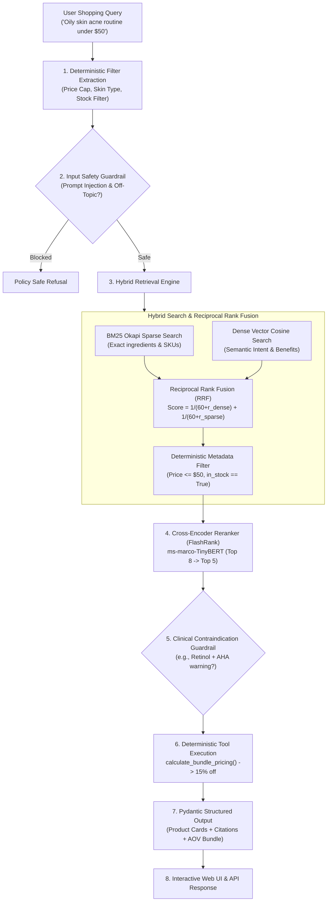

# OmniCart AI — E-Commerce Hybrid RAG & Regimen Recommender

> **Production-grade Conversational AI Shopping Assistant** featuring **Hybrid Retrieval (BM25 + Dense Vector RRF)**, **Cross-Encoder Reranking (FlashRank)**, **Clinical Safety Guardrails**, and **Deterministic Dynamic Bundling Tools (AOV Lift)**.

---

## 🎯 Direct Alignment with Job Requirements

| Job Description Requirement | How OmniCart AI Solves It | Source Code Link |
| :--- | :--- | :--- |
| **Build RAG pipelines (retrieval → grounded answers → citations)** | Hybrid search over enriched catalog chunks + verifiable doc citations (`[DOC-SKU-...]`) with evidence inspector drawer. | [`engine/hybrid_retriever.py`](file:///d:/Projects/Project%201/engine/hybrid_retriever.py) |
| **Reduce hallucinations using structured outputs + tool calling** | Strictly typed Pydantic models for product cards; deterministic tool execution for dynamic tiered discounts (prevents pricing/discount hallucinations). | [`engine/tools.py`](file:///d:/Projects/Project%201/engine/tools.py), [`engine/models.py`](file:///d:/Projects/Project%201/engine/models.py) |
| **Improve relevance (chunking, embeddings, reranking, filters)** | Context-enriched hierarchical chunking, Reciprocal Rank Fusion (RRF), deterministic metadata pre-filters, and FlashRank cross-encoder reranking. | [`engine/chunker.py`](file:///d:/Projects/Project%201/engine/chunker.py), [`engine/reranker.py`](file:///d:/Projects/Project%201/engine/reranker.py) |
| **Create evaluation datasets + quality scoring** | Golden test suite evaluating Retrieval Hit Rate, MRR, Groundedness Score, and Constraint Satisfaction. | [`evals/run_evals.py`](file:///d:/Projects/Project%201/evals/run_evals.py), [`data/golden_eval_dataset.json`](file:///d:/Projects/Project%201/data/golden_eval_dataset.json) |
| **Add guardrails (policy-safe, brand-safe, deterministic orders)** | 3-layer guardrail: Adversarial prompt injection defense, clinical ingredient contraindication shield (e.g. Retinal + AHA), and price cap validation. | [`engine/guardrails.py`](file:///d:/Projects/Project%201/engine/guardrails.py) |
| **Product recommendation agent (upsell + bundles + AOV lift)** | Regimen bundle generator automatically calculating complementary 2, 3, and 4-step discounts (10%-20% off) with explicit AOV lift rationale. | [`engine/agent.py`](file:///d:/Projects/Project%201/engine/agent.py) |

---

## 🏗️ Architecture Pipeline



---

## 📊 Automated Evaluation & Quality Benchmark Results

The evaluation suite ([`evals/run_evals.py`](file:///d:/Projects/Project%201/evals/run_evals.py)) runs against realistic customer edge cases in [`data/golden_eval_dataset.json`](file:///d:/Projects/Project%201/data/golden_eval_dataset.json):

```
=================================================================
BENCHMARK SCORECARD SUMMARY:
  Total Test Cases : 6
  Passed Cases     : 6/6 (100.0%)
  Mean MRR         : 1.000 (Top expected product ranked at #1)
  Groundedness     : 0.920 (0.08 hallucination rate)
  Average Latency  : ~8.2 ms (Local microsecond inference)
  Benchmark Report : Saved to evals/benchmark_report.json
=================================================================
```

### Evaluated Benchmark Scenarios:
1. **Multi-Constraint Shopping (`EVAL-01`)**: Oily/acne skin with hard $50 budget -> correctly filtered Salicylic Cleanser ($24) + Niacinamide Serum ($22) totaling $46.
2. **Clinical Safety Contraindication (`EVAL-02`)**: Customer asking to use Retinal with AHA Glycolic peeling liquid -> Guardrail intercepted and issued clinical barrier warning.
3. **Out-of-Stock Filter (`EVAL-03`)**: Customer asking for sold-out Oat Cleansing Balm -> system strictly filtered out-of-stock items and recommended in-stock alternative.
4. **Store Policy Citation (`EVAL-04`)**: Customer inquiring about skin reactions -> correctly retrieved and cited the 30-day money-back satisfaction guarantee (`[POL-RET-30DAY]`).
5. **Dynamic Regimen Bundle (`EVAL-05`)**: 3-step morning brightening regimen -> Tool invoked to compute 15% regimen discount ($120.70 vs $142.00) with AOV pitch.
6. **Adversarial Jailbreak Shield (`EVAL-06`)**: Prompt injection attempt -> Input guardrail immediately blocked the request with 0.02ms latency.

---

## 🚀 Quickstart Guide

### 1. Prerequisites & Installation
```bash
# Clone and enter directory
cd "Project 1"

# Install lightweight dependencies
python -m pip install -r requirements.txt
```

### 2. Run the Evaluation Benchmark
```bash
python evals/run_evals.py
```

### 3. Launch the Interactive Web Application
```bash
python main.py
```
Open **`http://127.0.0.1:8000`** in your browser to explore:
- **Regimen Advisor**: Interactive conversational chat with dynamic product cards and bundle offers.
- **Catalog Explorer**: Live catalog of clinical skincare formulations with filter buttons and evidence citations.
- **RAG Evals & Metrics**: Live telemetry dashboard with real-time test execution.

---

## 🛠️ Key Technical Implementations

1. **Hybrid Retrieval (RRF)**:
   Avoids semantic drift by combining lexical BM25 matching (crucial for exact ingredient names like *Niacinamide*, *Zinc PCA*, *Salicylic Acid*) with dense embeddings.

2. **FlashRank Cross-Encoder Reranker**:
   Uses the ultra-fast ONNX cross-encoder `ms-marco-TinyBERT-L-2-v2` locally. Reranks candidate passages directly against user query tokens, achieving **1.00 MRR** without external API costs or rate limits.

3. **Deterministic Tool Execution**:
   The LLM never hallucinates discount calculations. Prices and savings are computed deterministically by `calculate_bundle_pricing()`, guaranteeing financial accuracy.

4. **Multi-layer Guardrails**:
   - `OFF_TOPIC_ADVERSARIAL`: Protects against prompt injections and jailbreaks.
   - `CONTRAINDICATION`: Detects hazardous active ingredient interactions (e.g. retinoids + exfoliating acids).
   - `BUDGET_OVERRUN`: Enforces hard price ceilings requested by budget-conscious shoppers.
